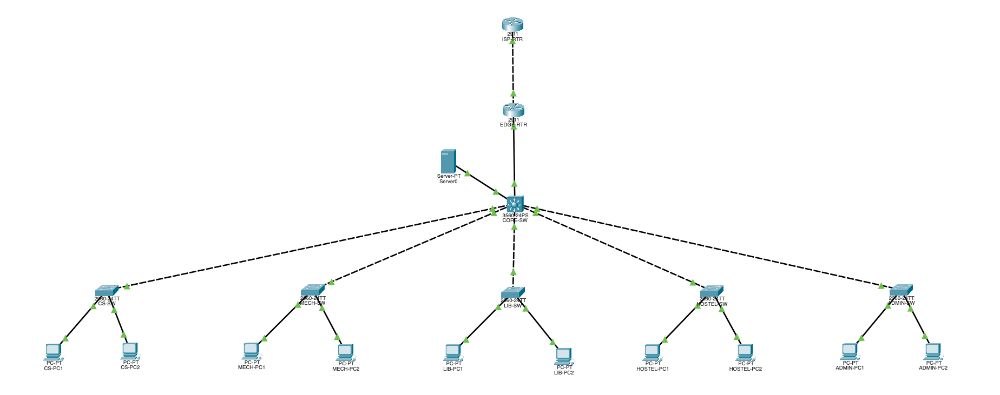

# University Campus Network

A university campus network designed and simulated using **Cisco Packet Tracer**.

## Project Overview

This project demonstrates an enterprise-style university network connecting multiple departments through VLAN segmentation, centralized DHCP services, and inter-VLAN routing.

## Network Topology

## Network Components

| Device | Quantity | Purpose |
|---|---:|---|
| Cisco 3560 Multilayer Switch | 1 | Core switching and routing |
| Cisco 2960 Switches | 5 | Department access switches |
| PCs | 10 | End-user devices |
| Server | 1 | Centralized DHCP services |
| Edge Router | 1 | Campus WAN connection |
| ISP Router | 1 | ISP network representation |

## VLAN and IP Addressing

| VLAN | Department | Network | Default Gateway |
|---|---|---|---|
| 10 | Computer Science | 192.168.10.0/24 | 192.168.10.1 |
| 20 | Mechanical | 192.168.20.0/24 | 192.168.20.1 |
| 30 | Library | 192.168.30.0/24 | 192.168.30.1 |
| 40 | Hostel | 192.168.40.0/24 | 192.168.40.1 |
| 50 | Administration | 192.168.50.0/24 | 192.168.50.1 |
| 99 | Management / Services | 192.168.99.0/24 | 192.168.99.1 |

## Technologies Implemented

- VLAN segmentation
- Access and trunk ports
- Inter-VLAN routing using SVIs
- Layer 3 switching
- Centralized DHCP configuration
- DHCP Relay using `ip helper-address`
- WAN connections between routers
- Network connectivity testing using ping

## Network Architecture

**PCs → Access Switches → Core Switch → Edge Router → ISP Router**

The Core Switch handles communication between different VLANs, while the Edge Router connects the campus network toward the ISP.

## Software Used

- Cisco Packet Tracer

## Project Files

- `University network.pkt` – Complete network simulation.
- `network-topology.png` – Network topology diagram.

## Future Improvements

- Spanning Tree Protocol (STP)
- NAT/PAT
- Access Control Lists (ACLs)
- SSH-based device management
- Switch port security
- OSPF
- EtherChannel

## Author

Ansh

Created as a Computer Networking project using Cisco Packet Tracer.
